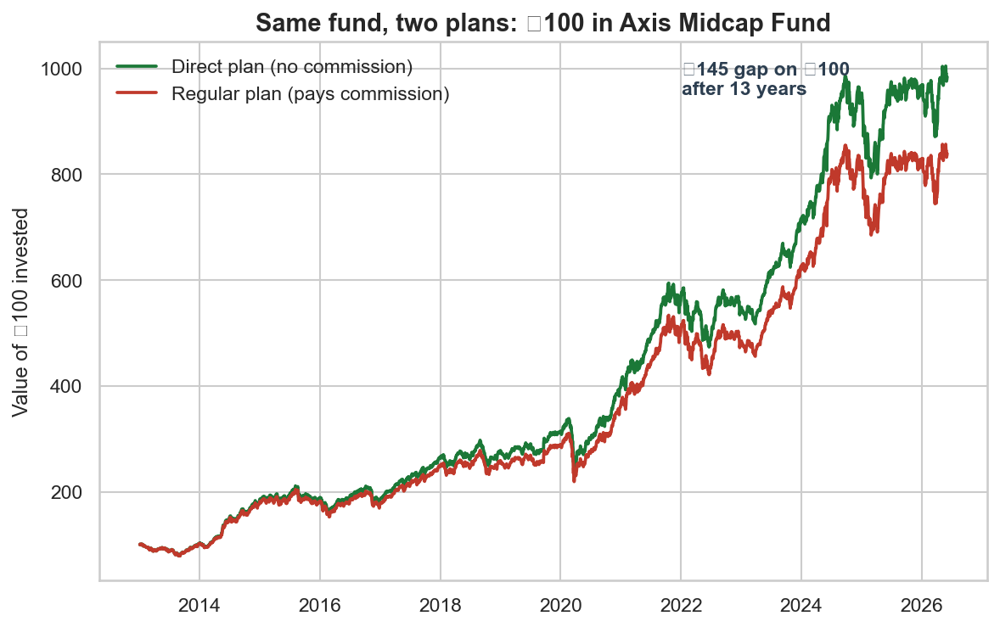
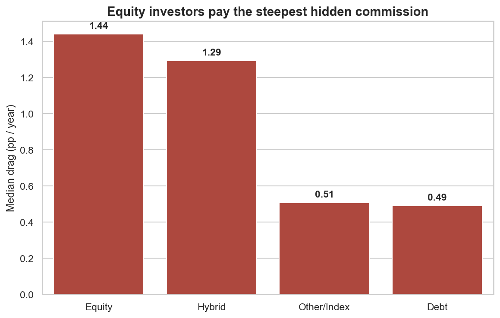
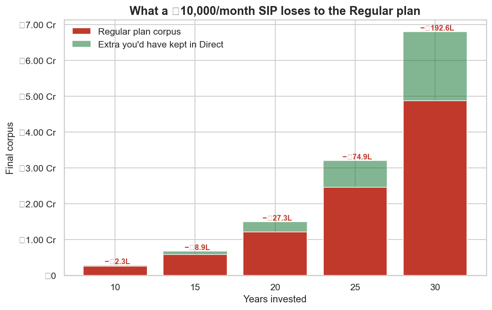

# The Hidden Cost of "Regular" Mutual Fund Plans in India

[](https://github.com/shaurya703/hidden-mutual-fund-fees/actions/workflows/ci.yml)

> Most Indians who invest in mutual funds are quietly sitting in the *costlier*
> version of the exact same fund — and losing lakhs to crores over a lifetime for
> nothing in return. This project measures that cost from official data, fund by fund.

---

## The problem (and why nobody looks at it)

Every open-ended Indian mutual fund is sold in two forms of the **identical
portfolio**:

| | **Regular plan** | **Direct plan** |
|---|---|---|
| Portfolio | Same stocks, same manager | Same stocks, same manager |
| Distributor commission | **Yes** — skimmed from the fund every year | **No** |
| How you usually get it | Default via banks, agents, many apps | You have to choose it |

SEBI made Direct plans mandatory in **January 2013**, yet most retail investors
have never heard of them and stay in the Regular version by default. Because the
two plans hold the *same* portfolio, **the gap between their returns is a clean,
assumption-free measurement of the commission you're paying** — and almost nobody
cross-checks it. This project does.

## Headline findings

- Across **1,084 cleanly matched funds** (50 fund houses, 2013–2026), the Direct
  plan beat the Regular plan in **99% of funds**.
- The typical fund skims **~0.8 percentage points/year** from Regular investors
  overall, and **~1.4 pp/year for equity funds** — the funds people hold longest.
- The penalty is a **flat toll**, uncorrelated with how well the fund performs
  (it's a fee, not a performance share).
- On a modest **₹10,000/month SIP** in a typical equity fund, the Regular plan
  costs roughly **₹27 lakh over 20 years (18% of the corpus)** and **~₹1.9 crore
  over 30 years (28% of the corpus)** — versus the identical Direct plan.
- The gap is statistically ironclad (paired Wilcoxon *p* ≈ 10⁻¹⁷⁶) and **structural**:
  fund category alone explains ~59% of its variation, concentrated in equity.

### 1. Same fund, two plans — the gap *is* the commission


### 2. Equity investors pay the steepest hidden fee


### 3. What it costs a real ₹10k/month SIP over a working life


## The takeaway, in one line

Switching from a Regular plan to the **Direct plan of the same fund** is one of the
only financial decisions that is pure upside: identical portfolio, lower cost, no
downside. For a default-Regular investor with no advice attached, the commission is
simply leakage.

---

## Dataset

- **Source:** [AMFI](https://www.amfiindia.com/) daily NAV history, accessed via the
  free public [mfapi.in](https://www.mfapi.in/) API (a mirror of AMFI's official files).
- **Universe:** all 37,631 listed schemes → filtered to **1,084 open-ended funds**
  with a matched Direct-Growth and Regular-Growth plan and ≥2 years of overlapping
  history.
- **Reproducibility:** `src/download.py` fetches and caches everything. The small
  scheme list and the processed dataset are committed; the bulk raw NAV cache
  (~300 MB) is regenerated by the download script (see `data/README.md`).

## How to reproduce

```bash
# 1. Environment (Python 3.12 recommended)
python3.12 -m venv .venv
source .venv/bin/activate
pip install -r requirements.txt

# 2. Download + cache the raw data (~5 min; skips anything already cached)
python -m src.download

# 3. Run the analysis, in order
jupyter notebook            # then run 01 -> 02 -> 03 -> 04
# or headless:
for nb in notebooks/0*.ipynb; do
  jupyter nbconvert --to notebook --execute --inplace "$nb"
done
```

## Project structure

```
hidden-mutual-fund-fees/
├── data/
│   ├── raw/                 scheme_list.json (committed) + nav/ cache (regenerated)
│   └── processed/           fund_returns.csv  <- the analysis-ready dataset
├── notebooks/
│   ├── 01_eda.ipynb         profile the raw data, surface the messiness & questions
│   ├── 02_cleaning.ipynb    parse names, pair plans, compute drag — every decision documented
│   ├── 03_analysis.ipynb    the four headline questions, with charts + interpretation
│   └── 04_modeling.ipynb    paired hypothesis test + regression + honest limitations
├── src/                     reusable logic, imported by the notebooks
│   ├── download.py          fetch & cache AMFI NAV data
│   ├── cleaning.py          name parsing, plan pairing, return/drag computation
│   ├── plotting.py          shared chart styling
│   └── paths.py             canonical project paths
├── reports/figures/         exported charts (embedded above)
├── requirements.txt
└── README.md
```

## Method, briefly

1. **Pair** each fund's Direct-Growth plan with its Regular-Growth twin via a
   normalised name key (exactly one candidate per side — correctness over coverage).
2. **Align** both plans to their common date window (Direct plans start in 2013).
3. **Measure** each plan's CAGR over that identical window; `drag = direct − regular`.
4. **Aggregate** robustly (median headline), translate into rupee SIP cost, and
   confirm with a paired test + regression.

Full reasoning, including every cleaning decision, lives in the notebooks.

## Tech stack

Python 3.12 · pandas · numpy · matplotlib · seaborn · scipy · statsmodels ·
scikit-learn · Jupyter · `requests`.

## Limitations & what I'd do next

- **Survivorship bias** (the effect is likely *understated*): only funds alive
  today with both plans are pairable; merged/closed funds — often poor performers —
  are absent.
- **Tracking noise** over short windows; mitigated with a ≥2-year floor and by
  reporting the median rather than the mean.
- **No AUM / exact expense ratio** in the free feed. **Next step:** join AMFI's TER
  disclosures to model the commission directly and add fund-size effects.
- **Distributor advice has value for some investors** — the commission is its price.
  The finding targets the large set of investors who hold Regular plans *by default*,
  with no advice attached.
- **Possible extensions:** a public "what is your Regular plan costing you?"
  calculator; per-category SIP cost tables; tracking how the gap evolves as SEBI
  tightens expense-ratio rules.

## Data caveat

Returns are historical (2013–2026) and not a guarantee of the future. The
*mechanism* — Direct = Regular minus commission — is structural and forward-looking;
the exact rupee figures depend on future returns.
